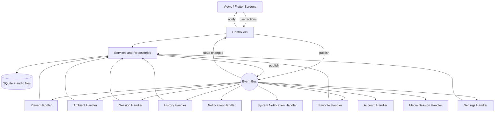

# SoundSphere

**Music · Focus · Balance**

An offline-first Flutter music player with a built-in **Focus Mode**: a Pomodoro-style study timer that controls your music and layers calming ambient sounds (rain, thunderstorm, waves and more) underneath.

Built with a **hybrid architecture: MVC + Event-Driven Architecture (EDA)**.

> University project · Platform: **Android** · Language: **Dart** · Framework: **Flutter** · IDE: **Android Studio**
>
> See `PROGRESS.md` for what is finished, what is tested and what is still to do.

---

## Table of Contents

1. [Overview](#1-overview)
2. [Why This Project](#2-why-this-project)
3. [Features](#3-features)
4. [How Focus Mode Works](#4-how-focus-mode-works)
5. [Screens](#5-screens)
6. [Visual Design](#6-visual-design)
7. [How Users Get Songs](#7-how-users-get-songs)
8. [Technology Stack](#8-technology-stack)
9. [Architecture: MVC + Event-Driven](#9-architecture-mvc--event-driven)
10. [Project Structure](#10-project-structure)
11. [Events and Handlers](#11-events-and-handlers)
12. [Database](#12-database)
13. [Key Code Examples](#13-key-code-examples)
14. [Setup on Windows with Android Studio](#14-setup-on-windows-with-android-studio)
15. [Running the App](#15-running-the-app)
16. [Assets: Logo, Ambient Sounds, Songs](#16-assets-logo-ambient-sounds-songs)
17. [Testing Checklist](#17-testing-checklist)
18. [Troubleshooting](#18-troubleshooting)
19. [Viva and Presentation Guide](#19-viva-and-presentation-guide)
20. [Roadmap](#20-roadmap)
21. [Legal Note on Media](#21-legal-note-on-media)
22. [Report Outline](#22-report-outline)
23. [References](#23-references)

---

## 1. Overview

SoundSphere lets a user:

- Play music stored on their phone, with a library, **playlists**, **Liked Songs**, favorites and history.
- Search their songs.
- Control playback with a mini player, a full Now Playing screen, a **queue** they can reorder, **shuffle** and **repeat**.
- Start a **Focus session** (Demo 10 s, 15, 25 or 45 minutes). The chosen playlist starts automatically. When the timer ends, the music fades out, the session is saved and a break message appears.
- Mix **ambient sounds** (Light Rain, Heavy Rain, Thunderstorm, Ocean Waves, Crowd, Bird, Airplane Cabin, Silent Train), each with its own volume.
- See focus statistics: today's total, sessions, streak, a 7-day chart and recent sessions.
- Find music already on the phone with an automatic **scan**, browse by **Albums** and **Artists**, and keep playing with the screen off (**background playback**).
- Review every focus session in **Focus history** and tune defaults in **Settings**.
- Use everything **offline**. Songs, playlists, favorites, history and sessions are stored on the device.

The app is designed so that **both MVC and Event-Driven Architecture have a real, demonstrable purpose**, not just names in a report.

---

## 2. Why This Project

| Problem with a plain music player | How SoundSphere solves it |
| --- | --- |
| Play and pause alone barely need events | Focus Mode creates events that trigger several independent reactions |
| A Spotify clone is too big and looks weak | Smaller scope with an original feature (Focus Mode and an ambient mixer) |
| Architecture exists only in a diagram | Events cause real behaviour that you can demo live |
| Hard to defend in a viva | Clear story: "one event, many independent reactions" |

---

## 3. Features

| # | Feature | Details |
| --- | --- | --- |
| 1 | Local library | Add songs from the phone with the file picker; they are copied into app storage and saved in SQLite |
| 2 | Search | Filters songs by title or artist as you type |
| 3 | Player | Play, pause, seek, next, previous |
| 4 | Shuffle and repeat | Shuffle on or off; repeat off, all or one |
| 5 | Queue | See what plays next; drag to reorder, remove, jump to a song; "Play next" and "Add to queue" |
| 6 | Mini player and Now Playing | Mini player on every tab; full screen player with artwork and seek bar |
| 7 | Favorites and Liked Songs | Heart any song; all hearted songs appear in a pinned "Liked Songs" list |
| 8 | Playlists | Create, add songs, remove songs, play, shuffle, delete |
| 9 | Recently played | History is saved when a song finishes |
| 10 | **Focus Mode** | Timer with pause, resume and stop; choose All songs, Liked Songs or any playlist |
| 11 | **Ambient mixer** | Eight looping sounds, each with on/off and volume; fade out when a session ends |
| 12 | Focus statistics | Today, sessions, completed, streak, last 7 days, recent sessions |
| 13 | Messages | Snack bars for session complete, session stopped and playback problems |
| 14 | **Local account** | Sign Up, Log In, Account and "Continue offline"; passwords are salted and hashed; the signed-in user is remembered between launches |
| 15 | **Break timer** | After each completed session a break starts automatically (Demo 5s, 5, 10 or 15 min); skip it or turn auto-break off |
| 16 | **Phone notifications** | When the app is in the background, a system notification appears when a focus session or break ends; permission is asked when the first session starts |
| 17 | **Albums and Artists** | Two extra Library tabs group songs by album or artist; tap a group to play or shuffle it |
| 18 | **Playlist rename** | Pencil icon on a playlist; the name updates everywhere |
| 19 | **Focus history** | Every session grouped by day with filters (All, Completed, Stopped); swipe left to delete |
| 20 | **Settings** | Default session length, auto-break and break length, phone notifications on or off, clear listening or focus history, links to Account and Scan |
| 21 | **Music scan** | Scans Music, Download and Documents for audio files and adds them without copying; artist, album and title come from file and folder names |
| 22 | **Background playback** | Music keeps playing with the screen off; notification and lock-screen controls (play, pause, next, previous, seek, stop) and headset buttons |

**Planned, not built yet:** Explore, music videos, online catalog, cloud sync, reading embedded tags and cover art. See [Roadmap](#20-roadmap).

---

## 4. How Focus Mode Works

1. The user opens **Focus**, picks a duration and a playlist, and optionally opens **Ambient sounds** to choose a mix.
2. Tap **Start**. `FocusStarted` is published. The music handler starts the playlist and the ambient handler starts the chosen sounds.
3. The ring counts down. The user can **Pause**, **Resume** or **Stop**.
4. When the timer reaches zero, `FocusCompleted` is published. Independent handlers react:
   - The music fades out and stops.
   - The ambient sounds fade out.
   - The session is saved to SQLite (and `SessionSaved` refreshes the stats).
   - A "Focus session complete" message appears.
   - A break starts (if auto-break is on): `BreakStarted` is published and the ring counts the break down. At zero, `BreakCompleted` is published and a "Break over" message appears. **Skip break** (or starting a new session) publishes `BreakSkipped`.
5. If the user stops early, `FocusCancelled` is published and an incomplete session is saved.

**Defaults:** Settings → Focus defaults sets the starting session length, whether a break starts automatically and how long it is. Changing a setting publishes `SettingsChanged`; `FocusController` applies only the values that changed, so a length picked on the Focus screen is not reset by an unrelated change.

**Demo tip:** choose **Demo 10s** to show the whole flow in ten seconds during a viva.

### Ambient sounds

- Each sound is a short looping audio file in `assets/ambient/` with an exact file name (see section 16).
- Each sound has its own audio player set to loop; its slider controls that player's volume.
- Ambient players do not request Android audio focus, so they never pause the music.
- A missing or misnamed file only silences that sound and shows a message.

---

## 5. Screens

### Built in the app

| Screen | What it does |
| --- | --- |
| Splash | Shows the logo and a loading bar |
| Home | Greeting, **Settings** and Account icons, Focus Mode card, recently played, your songs, mini player |
| Search | Search box and results with a "more" menu |
| Library | "Your Library" with **Playlists**, **Songs**, **Albums** and **Artists** tabs, a **+** button to create a playlist, a scan button and **Add songs** on the Songs tab, Liked Songs pinned at the top |
| Album / Artist | Cover, song count, Play, Shuffle and the song list |
| Playlist | Cover, song count, Play, Shuffle, song list, **rename**, delete (Liked Songs has neither) |
| Now Playing | Artwork, favorite, seek bar, shuffle, previous, play or pause, next, repeat, queue button, focus banner |
| Queue | Now playing, next up with drag handles and remove buttons, shuffle and repeat |
| Focus | Countdown ring (shows the break countdown during a break), duration chips, break length chips, auto-break switch, playlist picker, ambient sounds row, Start, Pause or Resume, Stop, Skip break |
| Ambient Sounds | Eight sounds with highlight and volume sliders |
| Focus Stats | Today's total, counts, streak, 7-day bars, recent sessions with a **See all** link |
| Focus History | All sessions grouped by day (Today, Yesterday, dates) with day totals, filter chips and swipe to delete |
| Scan for music | Explains the scan, asks for permission, shows progress and the result, offers Open app settings if permission was turned off |
| Settings | Account link, focus defaults, notifications, library tools (scan, add songs), clear listening or focus history, about |
| Log In | Email and password, "Sign up" link, **Continue offline** button |
| Sign Up | Name, email, password and confirmation with validation |
| Account | Avatar, name and email, edit name, log out (offline mode offers Sign up and Log in) |

### Designed but not yet coded

Explore and a Video Player are planned.

### Navigation

- **Bottom bar:** Home, Search, Library, Focus.
- **Mini player** sits above the bottom bar and opens Now Playing.
- **Now Playing → Queue** with the queue icon at the top right.
- **Focus → Ambient sounds** and **Focus → Stats → See all (Focus history)**.
- **Home → Settings** (gear icon) and **Home → Account**.
- **Library → Songs → scan icon**, or **Settings → Scan phone for music**.
- **Library → Albums or Artists → group** by tapping a row.
- **Library → Playlist** by tapping a playlist or Liked Songs.
- The "⋮" menu on any song: Play next, Add to queue, Add to playlist (and Remove from this playlist inside a playlist).

---

## 6. Visual Design

The visual identity comes from the SoundSphere logo: headphones around a music note with a leaf and a wave, in forest green, olive and terracotta on cream.

### Colors

| Role | Color | Hex |
| --- | --- | --- |
| Background (light screens) | Cream | `#F5EDDC` |
| Cards (light screens) | Light cream | `#FBF6EA` |
| Text and dark surfaces | Deep forest green | `#1A2D20` |
| Background (dark screens) | Dark forest | `#17261C` |
| Muted text (light screens) | Moss | `#56604A` |
| Muted text (dark screens) | Sage | `#B5BCA4` |
| Primary accent | Terracotta | `#CE7B4A` |
| Secondary accent | Olive | `#6B8F47` |

Text on terracotta buttons is dark green to keep contrast readable. The colors live in `lib/core/theme/app_colors.dart`.

### Light and dark screens

- **Light (cream):** Splash, Home, Search, Library, Playlist, Stats.
- **Dark (forest):** Now Playing, Queue, Focus, Ambient Sounds. These are used while listening or studying, so they are calmer.
- **Dark pieces on light screens:** the bottom bar, the mini player and the Focus card on Home.

### Typography and shape

- The theme asks for the **Outfit** font. If the font files are not added to the project, Flutter uses its default font (see section 18 to add Outfit).
- Rounded corners, 44 px minimum touch targets, Material icons.

### Design canvas

A set of 11 phone mockups (Splash, Sign Up, Log In, Home, Search, Library, Now Playing, Focus, Ambient Sounds, Stats, Account) was made as a design reference. The app follows it closely; screens added later (Queue, Playlist) follow the same style.

---

## 7. How Users Get Songs

| Option | How it works | Status |
| --- | --- | --- |
| **Add songs (file picker)** | Library → Songs → **Add songs**. The user picks audio files; the app copies them into its own folder and adds them to the database | **Built** |
| Bundled sample songs | A few royalty-free tracks in `assets/` for demos | Optional |
| **Automatic phone scan** | Library → Songs → scan icon (or Settings). Asks for permission, then adds every audio file in Music, Download and Documents without copying. Artist, album and title come from file and folder names | **Built** |
| Reading embedded tags and cover art | Needs a tag-reading package | Planned |
| Online catalog | Jamendo or Audius search and streaming | Optional, later |

When songs are added or scanned, a `LibraryUpdated` event is published and the library, home and search screens refresh themselves.

**Do not** try to stream Spotify or YouTube Music. Their terms do not allow apps to take their audio.

For the demo, keep **3 to 5 royalty-free songs** on the phone.

---

## 8. Technology Stack

| Purpose | Package |
| --- | --- |
| Framework | Flutter and Dart |
| Audio playback | `just_audio` (music player and one looping player per ambient sound) |
| State management | `provider` |
| Local database | `sqflite`, `path`, `path_provider` |
| File picking | `file_picker` (version 12 and newer: `FilePicker.pickFiles(...)` is a static call that returns a list) |
| Music scan permission | `permission_handler` (audio permission on Android 13+, storage on older versions) |
| Background playback | `audio_service` (media session, notification and lock-screen controls) |
| Password hashing | `crypto` (SHA-256 with a random salt) |
| Phone notifications | `flutter_local_notifications` (version 20 or newer: named parameters) |
| Icons | `cupertino_icons` and built-in Material icons |

Packages are added with `flutter pub add` so versions match your Flutter. The project does **not** use `google_fonts`.

---

## 9. Architecture: MVC + Event-Driven

> **MVC organises the app's structure and user actions. Events coordinate independent reactions to things that already happened.**

### Rule of thumb

- Use a **direct controller call** when one component asks another to do something (the user taps Pause, so the view calls the controller).
- Use an **event** when something happened and several unrelated parts may react (`FocusCompleted`).

Do **not** make every tap an event.

### Diagram



### MVC layers

| Layer | Folder | Examples |
| --- | --- | --- |
| **Model** | `lib/models/` | `Track`, `Playlist`, `FocusSession` |
| **View** | `lib/views/` | Home, Library, Playlist, Now Playing, Queue, Focus, Ambient, Stats |
| **Controller** | `lib/controllers/` | `PlayerController`, `LibraryController`, `PlaylistController`, `FocusController`, `AmbientController`, `StatsController` |
| Supporting layer | `lib/services/`, `lib/repositories/` | `PlayerService`, `AmbientService`, `ImportService`, SQLite repositories |

Services and repositories are a supporting layer under the controllers, not a replacement for MVC.

### Event-driven layers

| Part | Folder | Role |
| --- | --- | --- |
| **Event bus** | `lib/core/events/event_bus.dart` | One broadcast stream |
| **Events** | `lib/core/events/*_events.dart` | Immutable typed facts |
| **Handlers** | `lib/handlers/` | Independent listeners that react |

The publisher never knows who is listening. That loose coupling is the key idea.

### Media session (background playback)

`SoundSphereAudioHandler` (in `lib/services/`) is the app's `audio_service` handler. It reacts to the music player's own state and to `PlaybackStateChanged` events to keep the notification up to date, and forwards notification and headset buttons to `PlayerService`. Only the music player is attached; the ambient players stay independent, so ambient sounds never appear in the notification.

### Where both patterns meet

When the user taps a song, `PlayerController.playFromList()` publishes `TrackSelected` and `PlayerHandler` starts playback. Pause, next and seek are plain direct calls because only one component needs to react.

### Event rules

1. Events are **immutable** and **typed**.
2. Every event has **at least one consumer**.
3. Handlers subscribe **once** (each handler calls its own `dispose()` at the start of `init()`).
4. Handlers are **idempotent** (sessions are never saved twice, because the repository ignores a session with the same start time).
5. Handlers are **independent** of each other.
6. Subscriptions are cancelled on dispose.

---

## 10. Project Structure

```
lib/
├── main.dart                    # wires bus, repositories, services, handlers, controllers
├── main_handlers.dart           # keeps all handlers alive
├── app.dart                     # MaterialApp and theme
│
├── core/
│   ├── events/                  # event_bus, app_event, playback/focus/ambient/library/account/break/settings/scan events
│   ├── theme/                   # app_colors.dart, app_theme.dart
│   └── utils/format.dart
│
├── models/                      # M
│   ├── track.dart
│   ├── playlist.dart
│   ├── focus_session.dart
│   ├── user_profile.dart
│   ├── app_settings.dart
│   └── track_group.dart         # albums and artists grouping
│
├── views/                       # V
│   ├── app_shell.dart           # bottom navigation + mini player + messages
│   ├── splash/ home/ search/ library/ playlist/
│   ├── now_playing/ queue/ focus/ ambient/ stats/
│   ├── account/                 # auth_gate, log_in, sign_up, account screens, validators
│   ├── settings/ scan/          # settings_screen, scan_screen
│   ├── library/                 # library_screen, track_group_screen (album or artist)
│   ├── stats/                   # stats_screen, focus_history_screen
│   └── widgets/                 # art_tile, track_tile, mini_player, track_menu, playlist_dialogs
│
├── controllers/                 # C
│   ├── player_controller.dart
│   ├── library_controller.dart
│   ├── playlist_controller.dart
│   ├── focus_controller.dart
│   ├── ambient_controller.dart
│   ├── stats_controller.dart
│   ├── account_controller.dart
│   ├── settings_controller.dart
│   └── scan_controller.dart
│
├── handlers/                    # EDA
│   ├── player_handler.dart
│   ├── ambient_handler.dart
│   ├── session_handler.dart
│   ├── history_handler.dart
│   ├── favorite_handler.dart
│   ├── notification_handler.dart
│   ├── account_handler.dart
│   ├── system_notification_handler.dart
│   └── settings_handler.dart
│
├── services/
│   ├── player_service.dart      # just_audio wrapper, queue, shuffle, repeat
│   ├── ambient_service.dart     # one looping player per sound
│   ├── system_notification_service.dart  # phone notifications (never throws)
│   ├── import_service.dart      # file picker and copy into app storage
│   ├── scan_service.dart        # permission and scan of the phone's music folders
│   └── background_audio_handler.dart  # audio_service media session
│
└── repositories/
    ├── database_helper.dart
    ├── track_repository.dart
    ├── playlist_repository.dart
    ├── history_repository.dart
    ├── session_repository.dart
    ├── account_repository.dart
    └── settings_repository.dart

test/                            # unit tests (run with flutter test)

assets/
├── images/logo.png
└── ambient/                     # the 8 looping sound files
```

78 Dart files in `lib/` and 13 test files in `test/`.

---

## 11. Events and Handlers

| Event | Published by | Handled by | Reaction |
| --- | --- | --- | --- |
| `TrackSelected` | `PlayerController` | `PlayerHandler` | Start playing the chosen list (shuffled if requested) |
| `PlaybackStateChanged` | `PlayerService` | `PlayerController`, `SoundSphereAudioHandler` | Update play or pause state for every screen; update the notification with the current song |
| `QueueChanged` | `PlayerService` | `PlayerController` | Refresh queue, shuffle and repeat UI |
| `TrackPlaybackCompleted` | `PlayerService` | `PlayerHandler`, `HistoryHandler` | Play next song (respecting repeat); save one history row |
| `HistoryUpdated` | `HistoryHandler`, `SettingsController` | `LibraryController` | Refresh "Recently played" |
| `FavoriteChanged` | `LibraryController` | `FavoriteHandler` | Save to the database, then announce `LibraryUpdated` |
| `LibraryUpdated` | `ImportService`, `ScanService`, `FavoriteHandler` | `LibraryController` | Reload songs |
| `ScanCompleted` | `ScanService` | `NotificationHandler` | Show "Scan finished: N new songs added" |
| `FocusStarted` | `FocusController` | `PlayerHandler`, `AmbientHandler` | Start the chosen playlist; start the ambient mix |
| `FocusPaused` / `FocusResumed` | `FocusController` | `PlayerHandler` | Pause or resume music |
| `FocusCompleted` | `FocusController` | `PlayerHandler`, `AmbientHandler`, `SessionHandler`, `NotificationHandler` | Fade out music and ambient; save session; show message |
| `FocusCancelled` | `FocusController` | `PlayerHandler`, `AmbientHandler`, `SessionHandler`, `NotificationHandler` | Stop audio; save incomplete session; show message |
| `SessionSaved` | `SessionHandler` | `StatsController` | Refresh statistics |
| `FocusHistoryCleared` | `SettingsController` | `StatsController` | Refresh statistics after Clear focus history |
| `SettingsChanged` | `SettingsController` | `SettingsHandler`, `FocusController`, `SystemNotificationHandler` | Save the preferences; apply default length, auto-break and break length; turn phone notifications on or off |
| `AmbientSoundToggled` | `AmbientController` | `AmbientHandler` | Start or stop one sound |
| `AmbientVolumeChanged` | `AmbientController` | `AmbientHandler` | Change one sound's volume |
| `BreakStarted` | `FocusController` | `NotificationHandler` | Show "Break started" |
| `BreakCompleted` | `FocusController` | `NotificationHandler` | Show "Break over" |
| `BreakSkipped` | `FocusController` | `NotificationHandler` | Show "Break skipped"; the ring returns to the session timer |
| (focus and break events) | see rows above | `SystemNotificationHandler` | `FocusStarted` asks for notification permission; `FocusCompleted` and `BreakCompleted` show a phone notification only when the app is in the background |
| `AccountCreated` / `AccountLoggedIn` | `AccountController` | `AccountHandler` | Remember the signed-in user for the next launch |
| `GuestModeEntered` | `AccountController` | `AccountHandler` | Remember offline mode |
| `AccountLoggedOut` | `AccountController` | `AccountHandler`, `PlayerHandler`, `AmbientHandler`, `FocusController` | Forget the session; stop music and ambient; end any session or break |
| `AccountUpdated` | `AccountController` | `NotificationHandler` | Show "Profile updated" |
| `PlaybackFailed` | `PlayerService`, `AmbientService`, `PlayerHandler` | `NotificationHandler` | Show an error message |

### The headline demo: one event, many reactions

```
Timer reaches 00:00
        │
   FocusCompleted event
        │
  ┌─────┼──────────────┬──────────────┐
  ▼     ▼              ▼              ▼
Music   Ambient        Session        Message
fades   sounds fade    saved to       shown on
out     out            SQLite         screen
```

`FocusController` does not know any of these handlers exist.

---

## 12. Database

SQLite with `sqflite`, created on first launch in `database_helper.dart`.

| Table | Purpose |
| --- | --- |
| `tracks` | Songs: title, artist, album, file path (unique), duration, artwork path, favorite flag |
| `playlists` | Playlist name and creation time |
| `playlist_tracks` | Songs in each playlist with position (cascade delete) |
| `listening_history` | One row each time a song finishes |
| `focus_sessions` | Start time, planned minutes, actual seconds, completed flag, optional playlist |
| `ambient_mixes` | Reserved for saving mixes (not used yet) |
| `profile` | Reserved (the account feature uses its own tables below) |
| `local_account` | Local users: name, unique email, salt, password hash, created time (created on first use) |
| `app_settings` | Preferences as key and value: notifications, auto-break, break seconds, focus seconds (created on first use) |
| `account_session` | Remembered session: `user:<id>`, `guest` or empty (created on first use) |

Foreign keys are enabled with `PRAGMA foreign_keys = ON`. "Liked Songs" is not a table; it is built from `tracks.is_favorite`, so it uses the special id `-1` in code and is stored as no playlist in `focus_sessions`.

---

## 13. Key Code Examples

### Typed event bus

```dart
abstract class AppEvent {
  final DateTime timestamp = DateTime.now();
}

class EventBus {
  final StreamController<AppEvent> _controller =
      StreamController<AppEvent>.broadcast();

  void publish(AppEvent event) {
    if (!_controller.isClosed) _controller.add(event);
  }

  Stream<T> on<T extends AppEvent>() =>
      _controller.stream.where((e) => e is T).cast<T>();
}
```

### The controller only publishes

```dart
void _startTicker() {
  _timer = Timer.periodic(const Duration(seconds: 1), (timer) {
    remainingSeconds--;
    if (remainingSeconds <= 0) {
      timer.cancel();
      status = FocusStatus.idle;
      _bus.publish(FocusCompleted(_startedAt!, selectedSeconds, _runPlaylistId));
    }
    notifyListeners();
  });
}
```

### An independent handler

```dart
class AmbientHandler {
  void init() {
    dispose(); // never subscribe twice
    _subs.add(_bus.on<FocusStarted>().listen((_) => _service.startEnabled()));
    _subs.add(_bus.on<FocusCompleted>().listen((_) => _service.fadeOutAll()));
    _subs.add(_bus.on<FocusCancelled>().listen((_) => _service.stopAll()));
  }
}
```

### Wiring in `main.dart`

```dart
final bus = EventBus();
final handlers = AppHandlers(
  player: PlayerHandler(bus, playerService, trackRepo, playlistRepo),
  ambient: AmbientHandler(bus, ambientService),
  session: SessionHandler(bus, sessionRepo),
  history: HistoryHandler(bus, historyRepo),
  favorite: FavoriteHandler(bus, trackRepo),
  notification: NotificationHandler(bus),
  account: AccountHandler(bus, accountRepo),
  systemNotification: SystemNotificationHandler(bus, systemNotifications),
  settings: SettingsHandler(bus, settingsRepo),
)..initAll();
```

---

## 14. Setup on Windows with Android Studio

### Install

1. **Android Studio** from developer.android.com/studio. Let the setup wizard download the Android SDK.
2. **Flutter SDK** from docs.flutter.dev/get-started/install. Extract to a simple folder such as `C:\src\flutter` (not `Program Files`, no spaces).
3. Add the SDK's `bin` folder (for example `C:\src\flutter\bin`) to your **PATH** (Environment Variables → User variables → Path → New).
4. In Android Studio: **Settings → Plugins**, install **Flutter** (it also installs Dart). Set the Flutter SDK path.
5. In Android Studio: **Settings → Languages & Frameworks → Android SDK → SDK Tools**, tick **Android SDK Command-line Tools**.
6. Windows: turn on **Developer Mode** (Settings → Privacy & security → For developers).
7. Close and reopen all terminals and Android Studio.

### Check

```powershell
flutter doctor
flutter doctor --android-licenses
```

You want green checks for Flutter, Android toolchain and Android Studio. Ignore Chrome and Visual Studio warnings.

### Create and fill the project

1. Android Studio → **New Flutter Project** → Flutter → name `soundsphere`, platform **Android** only.
2. In a terminal inside the project folder:

```powershell
flutter pub add just_audio
flutter pub add provider
flutter pub add sqflite
flutter pub add path
flutter pub add path_provider
flutter pub add file_picker
flutter pub add crypto
flutter pub add flutter_local_notifications
flutter pub add audio_service
flutter pub add permission_handler
```

3. Copy the contents of the starter project's `lib` folder into your project's `lib` (replace `main.dart`) and its `assets` folder into the project root, next to `pubspec.yaml`.
4. Delete `test/widget_test.dart`.
5. In `pubspec.yaml`, under `flutter:`, keep exactly this indentation (spaces only):

```yaml
flutter:
  uses-material-design: true

  assets:
    - assets/images/
    - assets/ambient/
```

6. Run `flutter pub get`.

---

### Android setup for phone notifications

1. Make sure `flutter_local_notifications` is added (step above).
2. In `android/app/build.gradle.kts` (or `build.gradle`) turn on desugaring and Java 17:
   ```kotlin
   android {
       compileOptions {
           isCoreLibraryDesugaringEnabled = true
           sourceCompatibility = JavaVersion.VERSION_17
           targetCompatibility = JavaVersion.VERSION_17
       }
       kotlinOptions { jvmTarget = "17" }
   }
   dependencies {
       coreLibraryDesugaring("com.android.tools:desugar_jdk_libs:2.1.4")
   }
   ```
   (In a Groovy `build.gradle` write `coreLibraryDesugaringEnabled true`, `coreLibraryDesugaring 'com.android.tools:desugar_jdk_libs:2.1.4'`, and `jvmTarget = '17'`.)
3. In `android/app/src/main/AndroidManifest.xml`, inside `<manifest>` and above `<application>`, add:
   ```xml
   <uses-permission android:name="android.permission.POST_NOTIFICATIONS"/>
   ```
4. If Gradle complains about `compileSdk`, set `compileSdk = 36` in the same file.
5. Stop the app and run it again (a hot reload is not enough).

Note: notifications only appear while the app process is alive. While music plays, background playback keeps the app alive with the screen off (see the next section), so focus alerts also arrive then. Without music playing, Android may stop the app and the timer.

---

### Android setup for background playback and music scan

1. Make sure `audio_service` and `permission_handler` are added (the install list above).
2. In `android/app/src/main/AndroidManifest.xml`, add the `tools` namespace to the `<manifest>` tag:
   ```xml
   <manifest xmlns:android="http://schemas.android.com/apk/res/android"
       xmlns:tools="http://schemas.android.com/tools">
   ```
3. Above `<application>`, add the permissions (keep the notification one from the previous section):
   ```xml
   <uses-permission android:name="android.permission.WAKE_LOCK"/>
   <uses-permission android:name="android.permission.FOREGROUND_SERVICE"/>
   <uses-permission android:name="android.permission.FOREGROUND_SERVICE_MEDIA_PLAYBACK"/>
   <uses-permission android:name="android.permission.READ_MEDIA_AUDIO"/>
   <uses-permission android:name="android.permission.READ_EXTERNAL_STORAGE" android:maxSdkVersion="32"/>
   ```
4. Change the main activity to the audio_service one (replace `.MainActivity`; keep the other attributes of that `<activity>` as they are):
   ```xml
   <activity
       android:name="com.ryanheise.audioservice.AudioServiceActivity"
       ... >
   ```
5. Inside `<application>`, after the activity, add the service and the media button receiver:
   ```xml
   <service
       android:name="com.ryanheise.audioservice.AudioService"
       android:foregroundServiceType="mediaPlayback"
       android:exported="true"
       tools:ignore="Instantiatable">
       <intent-filter>
           <action android:name="android.media.browse.MediaBrowserService"/>
       </intent-filter>
   </service>

   <receiver
       android:name="com.ryanheise.audioservice.MediaButtonReceiver"
       android:exported="true"
       tools:ignore="Instantiatable">
       <intent-filter>
           <action android:name="android.intent.action.MEDIA_BUTTON"/>
       </intent-filter>
   </receiver>
   ```
6. Stop the app and run it again (a hot reload is not enough).

If this setup is missing, the app still runs; `main.dart` catches the error and music simply has no background controls.

---

## 15. Running the App

Connect your phone (USB debugging on) or start an emulator, then run in the project folder:

```powershell
flutter analyze
flutter run
```

While the app is running, press in the same terminal:

| Key | Action |
| --- | --- |
| `r` | Hot reload (apply code changes) |
| `R` | Hot restart |
| `q` | Quit |

After adding packages or assets, quit and run `flutter run` again. Hot reload does not pick them up.

If Android Studio's Run button fails (for example over a wireless connection), running `flutter run` from PowerShell works the same way.

---

## 16. Assets: Logo, Ambient Sounds, Songs

### Logo
Place `logo.png` in `assets/images/`. The splash screen shows it, and falls back to text if it is missing.

### Ambient sounds
Put looping audio files in `assets/ambient/` with **exactly** these names:

```
light_rain.mp3      heavy_rain.mp3      thunderstorm.mp3    ocean_waves.mp3
crowd.mp3           bird.mp3            airplane_cabin.mp3  silent_train.mp3
```

- Turn on **Show file name extensions** in File Explorer so you do not end up with `light_rain.mp3.mp3`.
- You can start with one or two files. A missing sound shows a message and stays silent.
- Files must be real audio and play in a normal media player.
- Use royalty-free or Creative Commons sounds and check each license.
- If you use another format, change the file names in `lib/services/ambient_service.dart`.

### Songs
Songs are not part of the project. Put a few royalty-free MP3s on the phone (Downloads or Music), then use **Library → Songs → Add songs**, or let **Scan phone for music** find them (Library → Songs → scan icon).

For the best Albums and Artists tabs when scanning, store files as `Music/Artist/Album/01 - Title.mp3` or name them `Artist - Title.mp3`. Embedded tags are not read. For an emulator, drag MP3 files onto the emulator window.

---

## 17. Testing Checklist

| # | Test | Expected result |
| --- | --- | --- |
| 1 | Open the app | Logo splash, then Home |
| 2 | Library → Songs → Add songs | Songs appear and a snack bar confirms |
| 3 | Tap a song | Plays; mini player appears |
| 4 | Open Now Playing | Seek bar and controls work |
| 5 | Heart then un-heart on Now Playing | Heart toggles both ways immediately |
| 6 | Shuffle and repeat | Icons highlight; next song order changes; repeat one replays |
| 7 | Queue (icon on Now Playing) | Drag to reorder, ✕ to remove, tap to jump |
| 8 | "⋮" → Play next / Add to queue | Message appears and the queue updates |
| 9 | Library → **+** → name → Create | Playlist appears |
| 10 | "⋮" → Add to playlist | Song is in the playlist |
| 11 | Open playlist → Play and Shuffle | Plays that playlist |
| 12 | Liked Songs | Shows all hearted songs |
| 13 | Search | List filters as you type |
| 14 | Focus → Demo 10s → Start | Music starts, ring fills, music fades out, message appears |
| 15 | Focus → choose a playlist | That playlist plays during the session |
| 16 | Ambient Sounds → turn on Light Rain | Rain loops without pausing the song |
| 17 | Start then Stop a session | Audio stops; Stats shows a "Stopped" session |
| 18 | Focus → Stats | New session listed with correct totals |
| 19 | Close and reopen the app | Songs, favorites, playlists and sessions are still there |
| 20 | Sign Up with a short name, bad email or password under 6 characters | Validation messages appear and no account is created |
| 21 | Sign Up with valid details | Account is created and the app opens on Home with your first name in the greeting |
| 22 | Sign Up again with the same email | "An account with this email already exists." |
| 23 | Log In with a wrong password | "Incorrect email or password." (same message for an unknown email) |
| 24 | Close and reopen the app while signed in | The login screen is skipped (session remembered) |
| 25 | Account → Edit name | Name changes and a "Profile updated." message appears |
| 26 | Log out during a focus session with music and ambient on | Music and ambient stop, the session and any break end, and the login screen appears |
| 27 | Log In screen → Continue offline | App opens; Account shows "Offline mode" with Create an account and Log in |
| 28 | Focus → Demo 10s with Demo 5s break → Start | After the session a break starts ("Break started") and the ring counts down 5 s, then "Break over" |
| 29 | During a break tap Skip break (or Start a new session) | "Break skipped." and the ring returns to the session timer |
| 30 | Turn auto-break off and finish a session | No break starts |
| 31 | Start a Demo 10s session, press Home (app in background) and wait | A phone notification "Focus session complete" appears; no notification when the app is open |
| 32 | Pause then Resume a focus session | Music pauses and resumes with the timer |

| 33 | Library → Playlists → open a playlist → pencil | Rename dialog opens with the current name; after Save the title and the Library row show the new name |
| 34 | Rename a playlist to an empty name | Nothing changes |
| 35 | Library → Albums, then Artists | Songs are grouped; tapping a group shows its songs with Play and Shuffle |
| 36 | Library → Songs → scan icon → Start scan (allow permission) | Progress shows, then "N new songs added" and the songs appear in the library |
| 37 | Scan again | "No new songs found" (already-added files are skipped) |
| 38 | Deny the scan permission twice | "Open app settings" button appears |
| 39 | Focus → Stats → See all | Sessions grouped by day; filters change the list; swipe a row left to delete it |
| 40 | Home → Settings → change Session length, go to Focus | The Focus ring shows the new default length |
| 41 | Settings → turn off Phone notifications, finish a session in the background | No phone notification; the in-app message still shows when the app is open |
| 42 | Settings → Clear listening history / Clear focus history | A confirmation, then Recently played or Stats are emptied |
| 43 | Play a song, press Home, lock the screen | Music keeps playing; notification shows title and artist |
| 44 | Use the notification and lock-screen buttons (pause, next, previous, seek) | The app follows; the in-app mini player stays in sync |

### Automated tests

```powershell
flutter test
```

Thirteen files in `test/` cover the event bus, the handlers (session, ambient, notification, system notification, favorite, history, account, settings), `FocusController` (including settings), `StatsController`, `SettingsController`, `ScanController`, `PlaylistController`, album and artist grouping, and the scan file-name rules. They use small fakes in place of the database and audio, so they run without a phone.

Run `flutter analyze` after each change. Warnings and "info" lines are fine; fix anything marked `error`.

---

## 18. Troubleshooting

| Problem | Fix |
| --- | --- |
| `flutter` is not recognized | The SDK's `bin` folder is not in PATH. Add it, then reopen the terminal |
| "No Windows desktop project configured" | The run target was Windows. Pick your phone or emulator instead |
| Android Studio Run hangs on a wireless device | Use a USB cable, or run `flutter run` from PowerShell |
| `FilePicker.platform` is not defined | New file_picker API. Use `await FilePicker.pickFiles(type: FileType.audio)` and treat an empty list as "cancelled" |
| `google_fonts` / `TextTheme` error | The project no longer uses `google_fonts`. Use the provided `app_theme.dart` |
| `RepeatMode` defined in two libraries | Flutter has its own `RepeatMode`. The project's enum is named `QueueRepeat` |
| `onReorder` is deprecated | Use `onReorderItem` (the project already does) |
| `Unable to find directory assets/ambient` | Create `assets/ambient` in the project root (not in `lib`) |
| Ambient sound is silent | File missing, misnamed or not audio. A message names the sound. Quit and run again after fixing |
| Songs do not play | Check the file is a valid audio file. A message says which song failed |
| Music pauses when ambient starts | Ambient players must use `handleInterruptions: false` and `handleAudioSessionActivation: false` (already in `ambient_service.dart`) |
| Font looks different from the design | The Outfit font files are not bundled. Download Outfit, add the files under `fonts/`, and declare `family: Outfit` under `fonts:` in `pubspec.yaml` |
| Notifications never appear | Allow notifications for the app in Android settings (Android 13+ asks when the first session starts). Check the desugaring and `POST_NOTIFICATIONS` steps in section 14, then fully stop and re-run the app. Alerts only show while the app is in the background, not when it is open |
| Build error about `coreLibraryDesugaring` or `compileSdk` | Follow "Android setup for phone notifications" in section 14 (desugaring on, Java 17, `compileSdk = 36`) |
| `flutter_local_notifications` call has wrong parameters | Version 20 and newer use named parameters (`initialize(settings: ...)`, `show(id: ..., title: ..., body: ..., notificationDetails: ...)`); the project already does |
| `Target of URI doesn't exist: package:crypto` | Run `flutter pub add crypto` |
| Cannot log in after reinstalling | Accounts live in the app's local database; uninstalling deletes them. Sign up again |
| Still signed in and want the login screen | Account → Log out |
| Music stops when the screen locks | Complete "Android setup for background playback" in section 14 (permissions, `AudioServiceActivity`, service and receiver), then stop and re-run the app |
| `AudioService.init` error in the log | The manifest is missing the audio_service activity, service or receiver. The app still plays in the foreground; fix the manifest as in section 14 |
| Scan finds nothing | Put audio files in Music, Download or Documents on the phone's main storage; files smaller than 50 KB, hidden folders and Ringtones, Notifications and Alarms folders are skipped |
| Scan asks for permission again and again | Open app settings from the Scan screen and allow music and audio access |
| `permission_handler` build error | Set `compileSdk = 36` in `android/app/build.gradle.kts` and run `flutter clean`, `flutter pub get` |
| Songs from a scan have no artist or album | Tags are not read. Use `Music/Artist/Album/01 - Title.mp3` folders or `Artist - Title.mp3` names |
| Scanned song stops working after moving or deleting the file | Scanned songs are not copied. Scan again after moving files, or use Add songs to copy them into the app |
| `flutter test` cannot find `package:soundsphere` | The project name in `pubspec.yaml` must be `soundsphere` (or change the imports in `test/`) |
| Strange build problems | `flutter clean`, then `flutter pub get`, then run again |

---

## 19. Viva and Presentation Guide

### Questions to prepare

1. **What is MVC and where is it?** `models`, `views`, `controllers`.
2. **What is EDA and where is it?** The event bus in `core/events` and the classes in `handlers`.
3. **Why hybrid?** MVC structures screens and user actions. Events let independent features react without being tightly coupled.
4. **Why not make everything an event?** It adds complexity without benefit. Direct calls are right for simple requests.
5. **Where is the loose coupling?** `FocusController` publishes `FocusCompleted` and imports no player, ambient, database or message code.
6. **How does it work offline?** Everything is stored locally in SQLite and app storage. No account is needed.
7. **How do you prevent duplicates?** Handlers call `dispose()` before subscribing, and `SessionRepository.save` ignores a repeated start time.
8. **How are passwords stored?** Never in plain text. `AccountRepository` creates a random 16-byte salt and stores the SHA-256 hash of `salt:password`. Login and unknown-email errors share one message so emails cannot be probed.
9. **How does the app remember the user?** `AccountController` publishes `AccountLoggedIn`; `AccountHandler` saves `user:<id>` (or `guest`) in the `account_session` table, and `init()` restores it on launch.
10. **Why do phone notifications use an event?** `SystemNotificationHandler` listens to `FocusCompleted` and `BreakCompleted` and checks the app lifecycle, so the timer code never knows notifications exist.
11. **What happens on logout?** One `AccountLoggedOut` event; the player and ambient handlers stop audio, `FocusController` ends any session or break, and `AccountHandler` forgets the session.
12. **How does background playback fit the architecture?** `SoundSphereAudioHandler` only reacts to the player's state and `PlaybackStateChanged` events and forwards button presses to `PlayerService`; no screen or controller knows about the notification.
13. **Why `audio_service` and not `just_audio_background`?** `just_audio_background` is built around one player whose every song carries a media tag; the independent looping ambient players do not fit that. With `audio_service`, a small handler attaches only the music player and the ambient players stay plain.
14. **How does the scan work without reading tags?** It walks the Music, Download and Documents folders with `dart:io`, skips hidden and sound folders and tiny files, and derives artist, album and title from `Artist/Album/01 - Title.mp3` style paths. Duplicates are ignored by the unique file path.
15. **How do Settings reach the timer?** `SettingsController` publishes `SettingsChanged`; `SettingsHandler` saves it, `FocusController` applies the changed values and `SystemNotificationHandler` toggles alerts. The controller does not know any of them.
16. **How do you know the handlers work?** Unit tests in `test/` publish events on a real `EventBus` and check the reaction with fake repositories and services.

### Live demos

1. **Track finishes:** the queue advances and Recently played updates, with no screen calling the history code.
2. **Focus session (Demo 10s):** music and ambient fade out, a message appears, and the session shows in Stats.
3. **Break timer:** finish a Demo 10s session with a Demo 5s break; show "Break started", the ring counting down, then "Break over" and Skip break, all from events.
4. **Logout fan-out:** start music, ambient and a session, log out, and show everything stopping from the single `AccountLoggedOut` event.
5. **Settings fan-out:** change the default session length and toggle notifications; show that `SettingsHandler` saves, `FocusController` updates the ring and the notification handler goes quiet, from one `SettingsChanged` event.
6. **Background playback:** start a song, lock the phone, and use the notification buttons.
7. **Run the tests:** `flutter test` on screen.
8. **Add a handler live:** create a small handler that listens to `FocusCompleted` (for example a "streak" handler), register it in `main_handlers.dart`, and show that `FocusController` did not change.

### Diagrams to include

Architecture diagram (section 9), event flow (section 11), database tables (section 12), and screenshots of the screens.

---

## 20. Roadmap

### Done
Core player, library, search, favorites and Liked Songs, playlists, queue, shuffle, repeat, history, Focus Mode, ambient mixer, statistics, SQLite storage, event system, **local Sign Up, Log In, Account and Continue offline**, **break timer with `BreakStarted`, `BreakCompleted`, `BreakSkipped` events**, **phone notifications when the app is in the background**, **playlist rename**, **Albums and Artists tabs**, **Focus history**, **Settings**, **automatic music scan**, **background playback**, **unit tests for the handlers and controllers**.

### Next
1. Explore screen (for example most played and recently added).
2. Read embedded tags and cover art during the scan.
3. Widget and integration tests for the screens.
4. Optional: music videos, online catalog, cloud sync.

### Cut order if time runs short
Cloud sync, videos, online catalog, Explore, advanced stats. **Never cut:** local playback, playlists and favorites, the event bus with working handlers, and Focus Mode with its multi-reaction demo.

---

## 21. Legal Note on Media

- Use **royalty-free or Creative Commons** audio, or media you have permission to use.
- Do **not** extract audio or video from Spotify or YouTube.
- Keep license information for every bundled track and ambient loop.

---

## 22. Report Outline

1. Introduction and problem statement
2. Objectives and scope
3. Requirements (functional and non-functional)
4. Architecture overview (MVC + EDA with rationale)
5. Architecture and event diagrams
6. Event catalogue (section 11)
7. Database design
8. UI and visual design (logo, palette, screens)
9. Implementation details (key classes and code excerpts)
10. Testing (checklist and results)
11. Challenges and solutions (section 18 and `PROGRESS.md`)
12. Limitations and future work
13. Conclusion
14. References

---

## 23. References

- just_audio: https://pub.dev/packages/just_audio
- provider: https://pub.dev/packages/provider
- sqflite: https://pub.dev/packages/sqflite
- file_picker: https://pub.dev/packages/file_picker
- audio_service: https://pub.dev/packages/audio_service
- permission_handler: https://pub.dev/packages/permission_handler
- flutter_local_notifications: https://pub.dev/packages/flutter_local_notifications
- Flutter app architecture guide: https://docs.flutter.dev/app-architecture
- Flutter install guide: https://docs.flutter.dev/get-started/install
